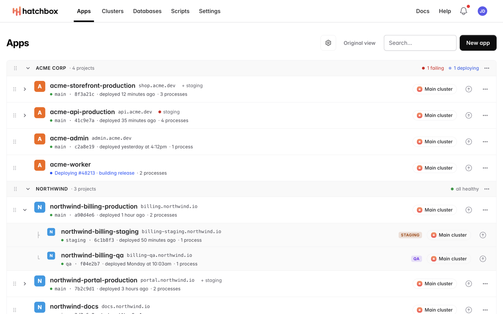
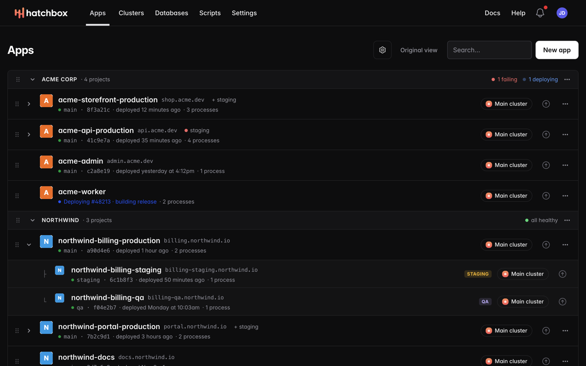
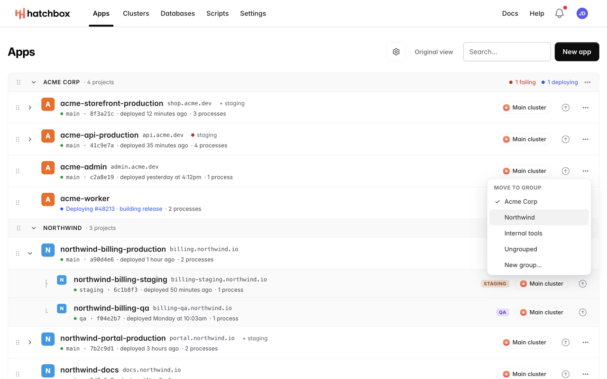
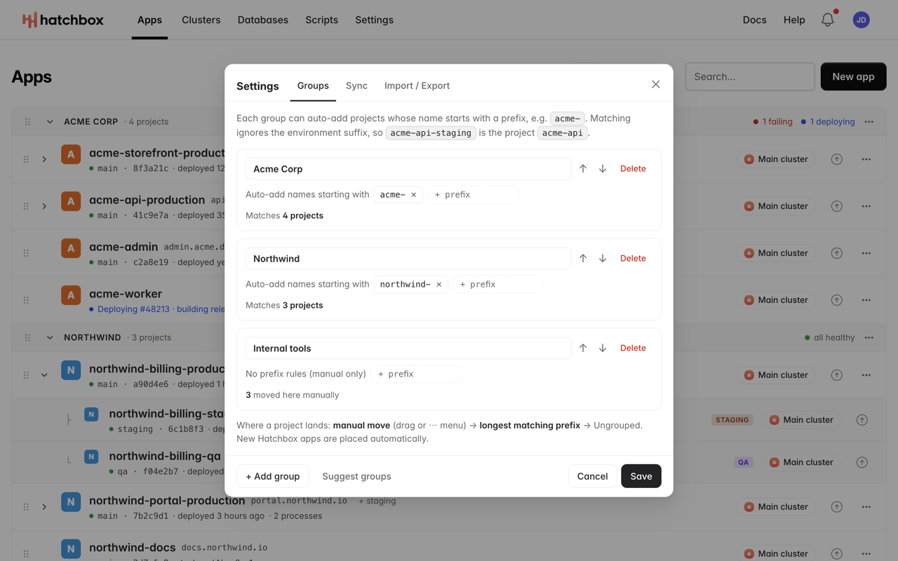
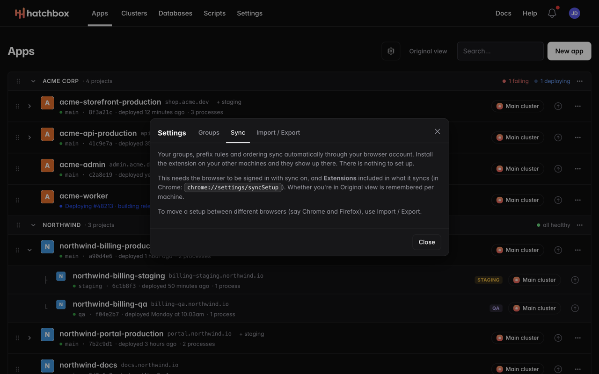

# Hatchbox Enhancer

A browser extension ([Chrome Web Store](https://chromewebstore.google.com/detail/bpiiminbibelibmggcbbioiifdooidkc)) and userscript that reorganizes the [Hatchbox](https://hatchbox.io/apps) apps list:

- **Environments nested under production.** `acme-api-staging` sits under `acme-api` (or `acme-api-production`), so each project is one block.
- **Your own groups.** Create groups, rename them, reorder them, collapse them.
- **Prefix rules.** Give a group one or more prefixes (e.g. `acme-`) and matching apps, including ones you create later, land there automatically.
- **Drag and drop.** Drag projects to reorder them or move them between groups. Drag group headers to reorder groups. The ⋯ menu on each row does the same without dragging.
- **Status roll-up.** Group headers show failing and deploying apps, so collapsed groups still tell you when something is wrong. Other environments start folded under production (your choice per project is remembered); a folded `+ staging` turns red when that app is failing.
- **Syncs across machines** through your browser account (extension), plus JSON import/export.
- Works in light and dark mode. **Original view** switches back to the stock Hatchbox list at any time.

It only rearranges the rows Hatchbox already renders. Links, deploy buttons and everything else stay Hatchbox's own.



<table>
  <tr>
    <td width="50%"><br><sub>Dark mode</sub></td>
    <td width="50%"><br><sub>Move a project to another group from its ⋯ menu</sub></td>
  </tr>
  <tr>
    <td width="50%"><br><sub>Groups and prefix rules</sub></td>
    <td width="50%"><br><sub>Sync across machines</sub></td>
  </tr>
</table>

<sub>Screenshots use made-up app names.</sub>

## Install

### Browser extension (recommended)

Chrome, Edge, Brave, Arc and other Chromium browsers.

- **From the Chrome Web Store:** [install Hatchbox Enhancer](https://chromewebstore.google.com/detail/bpiiminbibelibmggcbbioiifdooidkc).
- **From source:** clone this repo, run `npm run build`, open `chrome://extensions`, turn on **Developer mode**, click **Load unpacked**, and pick `dist/extension`.

The only permissions it asks for are `storage` and access to `hatchbox.io`.

### Userscript

For Tampermonkey or Violentmonkey users. **[Install the userscript](https://raw.githubusercontent.com/cmer/hatchbox-enhancer/main/hatchbox-enhancer.user.js)** and your userscript manager offers to add it. Updates are picked up automatically from this repo. It can sync across machines through a private GitHub Gist (see below).

## How apps are paired

The environment comes from the end of the app name, or from the app's cluster when the name has no suffix:

| Suffix | Environment |
| --- | --- |
| `-production`, `-prod` | production (the parent row) |
| `-staging`, `-stage`, `-stg` | staging |
| `-uat`, `-qa`, `-test`, `-demo`, `-preview`, `-dev`, `-development`, `-sandbox` | shown as their own environment |
| no suffix | the environment of the app's cluster, as shown on Hatchbox (production if the cluster has none) |

Everything before the suffix is the **project**. Groups, prefix rules and ordering all apply to projects, so a project's environments always move together. A project with no production app uses its staging (or other) app as the top row, labeled with its environment.

## Where a project lands

1. A **manual move** (drag, or ⋯ → Move to group) always wins.
2. Otherwise, the group with the **longest matching prefix**. A prefix like `acme-` matches `acme-api` and `acme-web`. `acme` also matches the project `acme` itself.
3. Otherwise, **Ungrouped**.

To undo a manual move, use ⋯ → *Follow prefix rules*.

## Sync

### Extension: browser account

The extension stores your setup in `chrome.storage.sync`, so it follows your browser account to every machine where the extension is installed. The browser has to be signed in, with **Extensions** included in what it syncs. Whether you're in Original view is stored per machine.

Browser sync gives each extension about 100 KB, which is plenty: large lists are split into chunks automatically. If a save to sync ever fails, the change is kept on that machine and a red cloud button explains what happened.

### Userscript: GitHub Gist

1. Create a [fine-grained GitHub token](https://github.com/settings/personal-access-tokens/new). Under **Account permissions**, set **Gists** to **Read and write**. No repository access is needed.
2. On the Hatchbox apps page, click the cloud button and paste the token.
3. The script creates a private gist named `hatchbox-enhancer.json`. On your other machines, paste a token the same way and the script finds that gist and loads it.

After that, changes push about a second and a half after you make them. The script pulls when the page loads and when you come back to the tab. If two machines both changed things, the most recent save wins. The cloud button's dot shows the state: green when synced, blue while syncing, red on errors.

The token is stored only in your userscript manager's storage and is only sent to `api.github.com`. It is never written to the gist or to exports.

### Between browsers

Extension sync stays within one browser family, and the extension and the userscript don't share settings. To move a setup across, or to share one with a teammate, use **Settings (gear icon) → Import / Export**.

## Development

```sh
npm run build     # dist/extension/ and hatchbox-enhancer.user.js
npm run package   # also dist/hatchbox-enhancer-<version>.zip for the Web Store
npm run icons     # regenerate extension/icons/
```

There are no dependencies. Layout:

- `store/screenshots/`: Web Store listing screenshots (1280×800).
- `src/core.js`: the organizer itself (reads the page, renders groups, menus, drag and drop, settings dialog).
- `src/platform-extension.js`: storage via `chrome.storage.sync`, with chunking and a local fallback.
- `src/platform-userscript.js`: storage via `GM_getValue`/`GM_setValue` (falling back to `localStorage`), plus GitHub Gist sync.
- `scripts/build.mjs`: wraps the core with each platform and writes both outputs.

`hatchbox-enhancer.user.js` is generated but committed, so its raw URL works as an install link. Edit `src/`, then rebuild. The version comes from `package.json`.

The userscript build falls back to `localStorage` when the `GM_*` APIs are missing, so you can paste it into the DevTools console on `/apps` to try a change quickly.

## Releasing

Changes go in [`CHANGELOG.md`](CHANGELOG.md) under **Unreleased**. Then:

```sh
npm run release -- patch      # or minor, major, or an exact x.y.z; add --dry-run to preview
```

This bumps the version in `package.json` and the manifest, moves the Unreleased notes under the new version, builds `dist/hatchbox-enhancer-<version>.zip`, commits, tags `v<version>`, pushes, and creates a GitHub release with the zip and userscript attached. In Claude Code, `/release` also writes the changelog entries from the commits since the last tag.

Userscript users update automatically from `main`. For the extension, upload the zip in the [Developer Dashboard](https://chrome.google.com/webstore/devconsole) under **Package → Upload new package** and submit for review. The store takes the `.zip` (it signs the extension itself) and requires each version to be higher than the last.

Listing notes: the single purpose is "reorganize the Hatchbox apps list". `storage` saves the user's groups and ordering. Host access to `hatchbox.io` is needed to rearrange that page. No data is collected or sent anywhere.

## License

[MIT](LICENSE)
